<picture>
  <source media="(prefers-color-scheme: dark)" srcset="https://raw.githubusercontent.com/th3kumar/th3kumar/output/hero-dark.svg">
  <source media="(prefers-color-scheme: light)" srcset="https://raw.githubusercontent.com/th3kumar/th3kumar/output/hero-light.svg">
  
</picture>

  <a href="https://anatomygo.in">anatomygo.in</a>&nbsp;&nbsp;·&nbsp;&nbsp;
  <a href="https://linkedin.com/in/mantu-kumar-ojha">LinkedIn</a>&nbsp;&nbsp;·&nbsp;&nbsp;
  <a href="mailto:mk420464@gmail.com">Say hi</a>

 

### Right now

- **Building [AnatomyGo](https://anatomygo.in)**, a 3D anatomy explorer for students. I'm the founder and the only engineer, so I get to obsess over every pin, panel and transition.
- **Thinking about motion:** natural easing, matte surfaces, and interfaces that feel calm instead of busy.

 

### Things I've made

  <a href="https://anatomygo.in"><picture><source media="(prefers-color-scheme: dark)" srcset="./assets/card-anatomygo-dark.svg"></picture></a>
  <a href="https://github.com/th3kumar/cineverse"><picture><source media="(prefers-color-scheme: dark)" srcset="./assets/card-cineverse-dark.svg"></picture></a>

  <a href="https://github.com/th3kumar/lick-my-app"><picture><source media="(prefers-color-scheme: dark)" srcset="./assets/card-tiernight-dark.svg"></picture></a>
  <a href="https://th3kumar.github.io/th3kumar/snoozz/"><picture><source media="(prefers-color-scheme: dark)" srcset="./assets/card-snoozz-dark.svg"></picture></a>

 

### Toolbox

<picture>
  <source media="(prefers-color-scheme: dark)" srcset="./assets/toolbox-dark.svg">
  
</picture>

  

### Happy to talk about

Jetpack Compose and the XML-to-Compose move · 3D on the web · motion and easing · design systems · turning analytics into product decisions

 

<picture>
  <source media="(prefers-color-scheme: dark)" srcset="./assets/footer-dark.svg">
  
</picture>
